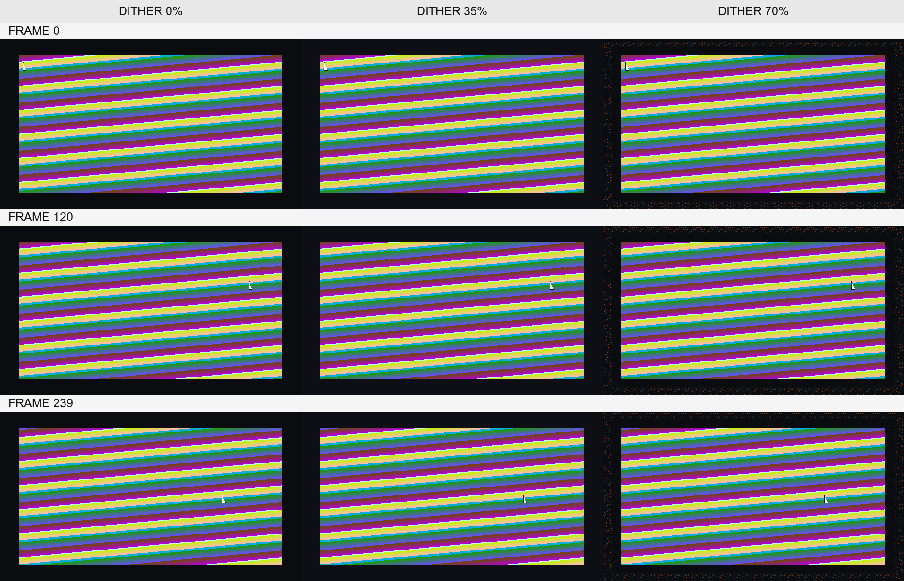
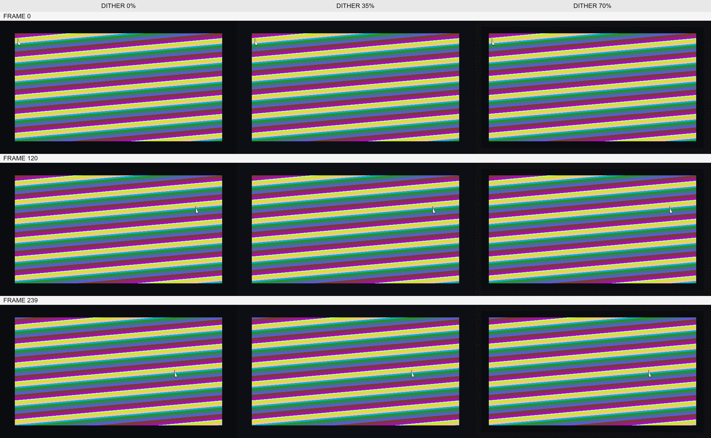
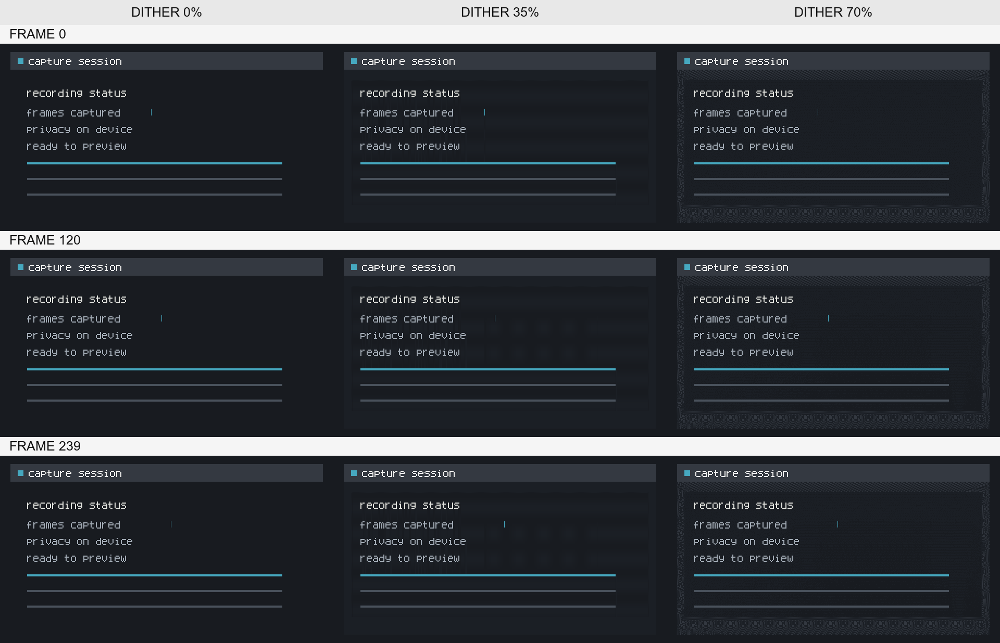
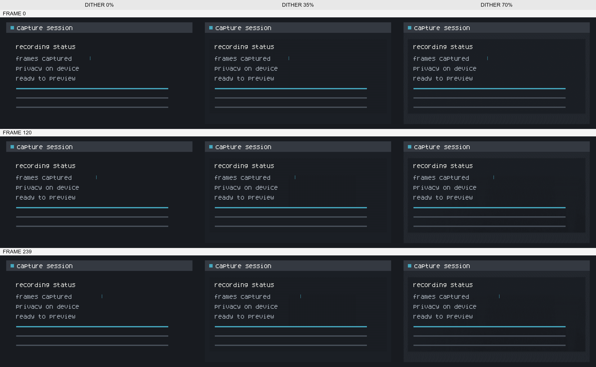

# imagemagick dither quality review — 2026-10-24

## scope

the architect reviewed full-sequence ImageMagick prototype samples at native size and 2×. each sheet compares diffusion settings 0%, 35%, and 70% at frames 0, 120, and 239 for two synthetic 640×360 fixtures. the samples are visual evidence only; they do not select ImageMagick as the release encoder or establish comparative performance.

## result

the architect confirmed that these samples meet the approved quality floor: text remains legible at native scale, cursor edges remain clear, and gradients show no distracting banding or flicker. at 2×, 70% diffusion shows visible speckling in flat regions of the static UI sample; the architect accepted this within the approved floor. the 0% and 35% samples appear clean in the reviewed frames.

this review covers the shown frames and fixtures only. it does not prove that every setting and capture will meet the floor, especially temporal flicker across a full animation. candidate selection still requires the complete documented comparison and license review.

## full-sequence pilot records

each output contained 240 frames at 640×360, 10.0 seconds, with infinite looping and the expected centisecond schedule `[4, 4, 5, 4, 4, 4]` repeated 40 times. the elapsed values below are one warm sample per setting from a quality pilot, not comparable performance evidence. peak resident memory was unavailable; workspace size was not a valid substitute.

the pilot ran on the approved reference machine, a MacBook Air with Apple M2 and 8 GB memory, on macOS 27.0.1 build 26A434 with low power mode off. this was not a performance-baseline run: it has no cold/warm series, p90, separate RSS measurement, or comparative candidate path.

| fixture | diffusion | warm seconds | bytes | sha-256 |
| --- | ---: | ---: | ---: | --- |
| high-motion gradient/cursor | 0% | 16.779 | 10,770,609 | `ccbe3b33e44df57b05b0415bbc2a7be3da2ded31d35c7db3bab5eb511f57a053` |
| high-motion gradient/cursor | 35% | 16.184 | 9,524,098 | `e69ea343db4da5f0eda75b4aef35db7dd91edf8347ad128433b1eace8a288830` |
| high-motion gradient/cursor | 70% | 17.477 | 13,663,171 | `ebc6d7f0a707ea49e2b44d2fc95b7c00e71b82efcc9295326e49b0b5adfcf17d` |
| mostly static UI | 0% | 27.099 | 10,577 | `c9a9ed6fa68e249d301a93a5db277f500b242777d183d1706b2572679df083c5` |
| mostly static UI | 35% | 24.687 | 30,017 | `c05c2c3d5c1e0c2e9762d976722bf74bb1fe4df3cf4637fdb01764f9c517f67a` |
| mostly static UI | 70% | 15.634 | 1,186,099 | `b775c60ae5c01afcf019503dfd27403af56bceaeec766d711797727edd0d6a02` |

## reviewed samples

### high-motion gradient and cursor

### mostly static UI

