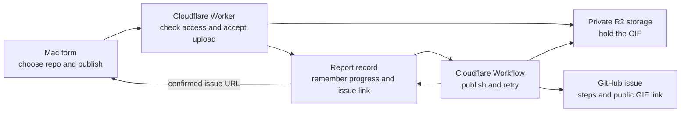

# share as bug report

record and edit a GIF, then choose **share as bug report…** from the preview. connect GitHub once using the short code in the Mac form. choose a public repository, enter an issue title, steps, and expected and actual behavior, then click **publish to GitHub**. that click sends the displayed GIF and report. gifferent opens the issue once GitHub confirms it. the first eight recently used repositories for each account are kept on the Mac.

## what happens if a step fails

| step | what happens |
| --- | --- |
| connect GitHub | an expired code can be replaced. select repositories on GitHub, then refresh the picker. an organization may require its administrator to approve access. |
| choose a repo | the list includes permitted public repositories with Issues enabled. a pasted GitHub link selects a repo already on that list. grant access on GitHub if the repo is missing. |
| upload | the limit is 9 MB. cancellation and upload errors leave the preview available. retrying the same file and fields reuses the report ID. an interrupted upload can still have reached Cloudflare, so the Mac remembers its latest ID for that account. |
| publish | Cloudflare continues after the Mac closes. a temporary failure is retried without reuploading the GIF. reopen the share form to check the last report. if GitHub access has expired, reconnect. if publishing ended with a clear rejection, submit again after fixing access. |
| GitHub reply is lost | the Workflow looks for the report ID on recent GitHub issues. if it can confirm the issue, it finishes. if it cannot, it shows a manual check message and avoids creating a second issue. an issue that remains unconfirmed can have an unavailable GIF link. |
| cleanup | the Workflow deletes the temporary GIF after publication or failure. an upload that never finishes expires after 15 minutes. a storage rule is a backstop. published GIFs remain in R2 until the operator removes them. |

The Worker handles short requests such as listing repositories, accepting the upload, and reading status. Cloudflare Workflows remembers the long-running job and schedules retries even when the Mac is offline. The report record keeps each job's status and whether a GitHub create request might already have happened. The GitHub API has no request key that guarantees issue deduplication. [Cloudflare Workflows steps](https://developers.cloudflare.com/workflows/build/workers-api/) · [GitHub Issues API](https://docs.github.com/en/rest/issues/issues#create-an-issue)

## privacy

capture, editing, and compression stay on the Mac. uploads are private in storage. the issue and its GIF link are public after confirmed publication. changing a repository to private does not make an already shared GIF private. an operator can remove the clip from the `published/` prefix if the link should stop working.

GitHub credentials stay on Cloudflare. gifferent stores its own connection key in Keychain. sign out from the form to clear that connection. Cloudflare removes expired connection records after 30 days. GitHub permissions can also be revoked through GitHub or the repository's installation settings. [GitHub App device sign-in](https://docs.github.com/en/apps/creating-github-apps/authenticating-with-a-github-app/generating-a-user-access-token-for-a-github-app#using-the-device-flow-to-generate-a-user-access-token)

## test locally

run `npm ci` and `npm test` from `BugReports` with Node 22.13 or later. the suite starts Wrangler with local storage and Workflows and a loopback stand-in for GitHub. it checks account separation, allowed repositories, duplicate submits, a rate limit, a lost reply, rejection, cleanup, and byte-for-byte GIF delivery.

to open the native form against local services, copy `.dev.vars.example` to `.dev.vars` if the file is absent. run `node test/mock-github.mjs` and `npm run dev` from `BugReports` in separate terminals. set `GIFFERENT_REPORT_ORIGIN=http://127.0.0.1:8787` as an Xcode Run environment variable. the fixture accepts sign-in without contacting GitHub. exercise the form with a synthetic recording.

## deploy

1. enable R2 in the selected Cloudflare account. create the private bucket configured in `BugReports/wrangler.jsonc`. leave bucket public access off. add the cleanup rule with `npx wrangler r2 bucket lifecycle add gifferent-bug-report-clips abandoned-drafts draft/ --expire-days 3`.
2. register a GitHub App with **Device Flow** enabled, expiring user tokens enabled, and **Issues: read and write**. leave repository metadata at its default read-only access. install on a disposable public repo for the first hosted verification. use only the repository permissions you need.
3. set `GITHUB_CLIENT_ID` and `GITHUB_APP_SLUG` in the Worker configuration. set `PUBLIC_ORIGIN` to the exact HTTPS origin for the Worker, without a trailing slash. run `npx wrangler deploy` from `BugReports`. the device flow does not require an app secret or private key.
4. set the Xcode build setting `GIFFERENT_REPORT_ORIGIN` to that HTTPS origin in distribution builds. the build includes the address in the app's Info.plist. use a Debug Run environment variable for local development.
5. record a real GIF and publish it to the test repo. quit gifferent after the upload, then reopen the share form to check publication. confirm the issue and public clip from a signed-out browser. test a denied repository and check Cloudflare's Workflow run before shipping to users.
